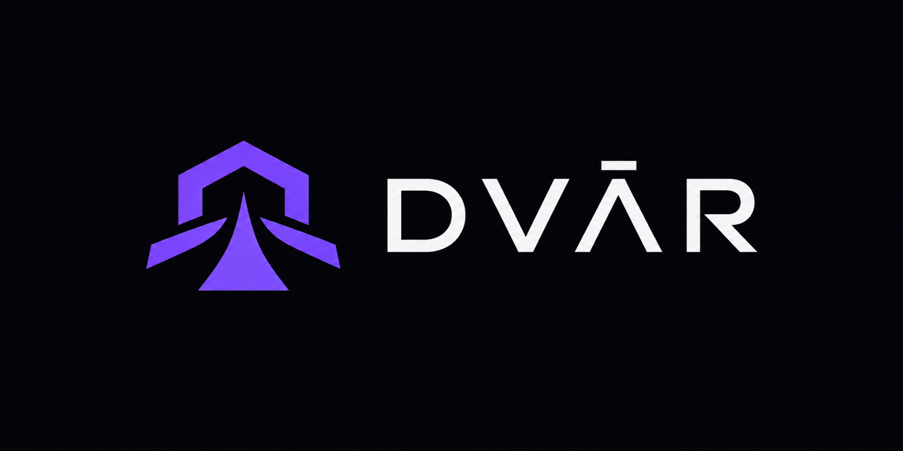

<p align="center">
<a href="https://github.com/Dhruv9449/Dvar">
	
</a>
	<h2 align="center"> Dvar 🚪</h2>
	<h4 align="center"> द्वार, Sanskrit for "doorway". A tiny macOS default browser that opens every link in the right Chrome profile. </h4>
</p>

<p align="center">
<a href="https://www.swift.org/"></a>
<a href="https://www.apple.com/macos/"></a>
<a href="LICENSE"></a>
</p>

<br>

Click a GitHub link in Slack and it opens in your Work profile. Click a YouTube link in Mail and it opens in Personal. Dvar sits between macOS and Chrome as your default browser, checks a short list of rules, and hands the link to the right profile.

<br>

## Table of Contents
- [Key Features](#key-features)
- [Tech Stack and Dependencies](#tech-stack-and-dependencies)
- [Setting-up and Installation](#setting-up-and-installation)
  - [Requirements](#requirements)
  - [Cloning repository](#cloning-repository)
  - [Installing](#installing)
  - [Making Dvar the default browser](#making-dvar-the-default-browser)
  - [Granting access to Chrome's profiles](#granting-access-to-chromes-profiles)
- [Usage](#usage)
  - [Settings window](#settings-window)
  - [CLI](#cli)
  - [Writing rules](#writing-rules)
  - [Config file](#config-file)
- [How it works](#how-it-works)
- [Development](#development)
- [Uninstalling](#uninstalling)
- [License](#license)
- [Developer](#developer)

<br>
<br>

## Key Features
- [x] **🔀 Route links by domain, path, or regex**
- [x] **💬 Route links by the app they were clicked in** (Slack, Mail, VS Code, ...)
- [x] **🖥️ Native settings window** to add, reorder and test rules
- [x] **⌨️ Full CLI** for scripting and quick edits
- [x] **🧪 Live tester** to see which profile a URL will open in before saving
- [x] **🪶 Lightweight**, a ~600 KB native binary with no dependencies, no Dock icon
- [x] **🌐 Works with Chrome, Chrome Beta/Dev/Canary, Chromium, Brave and Edge**

<br>
<br>

## Tech Stack and Dependencies
- [Swift](https://www.swift.org/) with AppKit and [SwiftUI](https://developer.apple.com/xcode/swiftui/)
- [LaunchServices](https://developer.apple.com/documentation/coreservices/launch_services) for handling `http`/`https` links
- No third-party dependencies

<br>
<br>

## Setting-up and Installation

### Requirements
- macOS 13 or later
- Xcode command line tools

```zsh
xcode-select --install
```

<br>

### Cloning repository

```zsh
git clone git@github.com:Dhruv9449/Dvar.git
```

or

```zsh
git clone https://github.com/Dhruv9449/Dvar.git
```

<br>

### Installing

```zsh
cd Dvar
make install
```

This installs `~/Applications/Dvar.app` and links the `dvar` CLI into `~/.local/bin`. If that folder isn't on your `PATH`, add it or run `make install BIN_DIR=/usr/local/bin`.

<p>

Dvar shows up in Spotlight and Finder with this icon. Opening it brings up the settings window; closing the window leaves it running quietly in the background.
</p>
<br clear="left"/>

<br>

### Making Dvar the default browser

Click **Make default** in the settings window, or run:

```zsh
dvar set-default-browser
```

macOS asks you to confirm the change.

<br>

### Granting access to Chrome's profiles

Chrome keeps its profile list inside its own data folder, which macOS protects from other apps. Give Dvar access once:

1. Open **System Settings → Privacy & Security → Full Disk Access** (the settings window has a button for this).
2. Add **Dvar** from `~/Applications` and turn it on.
3. Click **Retry** in the settings window.

Dvar caches the profile list in `~/.config/dvar/`, so it only needs to read it once. The build pins the app's signature to its bundle id, so the grant survives rebuilds.

Prefer not to grant access? Name profiles by their directory in rules instead (`Profile 1`). Open `chrome://version` in a profile and look at the end of **Profile Path**.

<br>
<br>

## Usage

### Settings window

Open **Dvar** from Spotlight, or run `dvar ui`. From there you can:

- pick the browser and the profile for links that no rule matches
- add, edit, delete and drag-reorder rules, choosing profiles from your real Chrome profiles and apps from the ones currently running
- try a URL and see which profile it would open in, before saving
- make Dvar the default browser

Invalid rules (an empty pattern or a broken regex) are flagged inline and block saving.

<br>

### CLI

Use the following command for help -

```zsh
dvar --help
```

```zsh
dvar profiles
# DIRECTORY  NAME / EMAIL
# Default    Personal  <me@gmail.com>
# Profile 1  Work      <me@mycompany.com>

dvar default Personal
dvar add '*.mycompany.com' Work
dvar add github.com/mycompany @mycompany.com
dvar add Work --from Slack
dvar add '^https://docs\.google\.com/.*/d/1AbC' Work --regex

dvar rules
#   1. match *.mycompany.com  →  Work [Profile 1, me@mycompany.com]
#   2. match github.com/mycompany  →  Work [Profile 1, me@mycompany.com]
#   ...
#   default  →  Personal [Default, me@gmail.com]

dvar test https://github.com/mycompany/api/pull/42
# Work [Profile 1, me@mycompany.com]  via rule #2: match github.com/mycompany
```

| Command | What it does |
|---------|--------------|
| `dvar ui` | Open the settings window |
| `dvar profiles` | List the browser's profiles |
| `dvar rules` | List rules in match order |
| `dvar add <pattern> <profile> [--regex] [--from <app>] [--at <n>]` | Add a rule |
| `dvar remove <n>` / `dvar move <n> <m>` | Delete or reorder a rule |
| `dvar default <profile>\|--clear` | Profile for links no rule matches |
| `dvar browser <name>` | Switch browser (`chrome`, `chrome-beta`, `chrome-dev`, `chrome-canary`, `chromium`, `brave`, `edge`) |
| `dvar test <url> [--from <app>]` | Show which profile a URL would open in |
| `dvar open <url>` | Route and open a URL now |
| `dvar edit` | Open the config in `$EDITOR` |
| `dvar status` | Paths, browser, and whether Dvar is the default browser |

<br>

### Writing rules

Rules are checked top to bottom and the first match wins. Every condition set on a rule must match.

| Field | Meaning |
|-------|---------|
| `match` | Glob on the URL without its scheme. Without a `/` it matches the host only: `*.mycompany.com` covers `mycompany.com` and every subdomain, while `notion.so` covers only `notion.so`. With a `/` the host and path are matched separately, and `github.com/mycompany` also covers everything under it (but not `github.com/mycompany-fork`). Case-insensitive. |
| `regex` | Case-insensitive regular expression searched in the full URL. |
| `from` | The app the link was clicked in, by name (`Slack`) or bundle id (`com.tinyspeck.slackmacgap`). |
| `profile` | A display name (`Work`), an email, `@domain` (any profile whose email is on that domain), or a directory (`Profile 1`). |

If a profile can't be found, the link opens without one rather than making Chrome create a new empty profile.

<br>

### Config file

Rules live in `~/.config/dvar/config.json` and apply to the next click; nothing needs restarting. See [config.example.json](config.example.json).

```json
{
  "browser": "chrome",
  "default": "Personal",
  "rules": [
    { "match": "*.mycompany.com", "profile": "Work" },
    { "match": "github.com/mycompany", "profile": "@mycompany.com" },
    { "from": "Slack", "profile": "Work" }
  ]
}
```

<br>
<br>

## How it works

`Dvar.app` is a background app (no Dock icon) registered for `http` and `https`. When macOS hands it a link, it reloads the config, picks a profile and starts the browser with `--profile-directory=<dir> <url>`. If the browser is already running, that hands the URL to the open window and exits. The app the link came from is read from the sender of the open-URL Apple Event.

Every routed link is logged to `~/Library/Logs/dvar.log`, which is the first place to look if a link opens in the wrong profile.

<br>
<br>

## Development

```zsh
make build   # build/dvar
make test    # CLI tests against a fake config and Chrome profile list
make app     # build/Dvar.app
```

<br>
<br>

## Uninstalling

```zsh
make uninstall
```

Then pick another default browser in **System Settings → Desktop & Dock**.

<br>
<br>

## License

Copyright © 2026 Dhruv9449  
[MIT License](LICENSE)

<br>
<br>

## Developer

<table>
	<tr align="center">
		<td>
		Dhruv Shah
		<p align="center">
			
		</p>
			<p align="center">
				<a href = "https://github.com/Dhruv9449">
					
				</a>
				<a href = "https://www.linkedin.com/in/Dhruv9449" target="_blank">
					
				</a>
				<a href = "mailto:dhruvshahrds@gmail.com" target="_blank">
					
				</a>
			</p>
		</td>
	</tr>
</table>

<p align="center">
	Made with ❤️ by <a href="https://github.com/Dhruv9449">Dhruv Shah</a>
</p>
